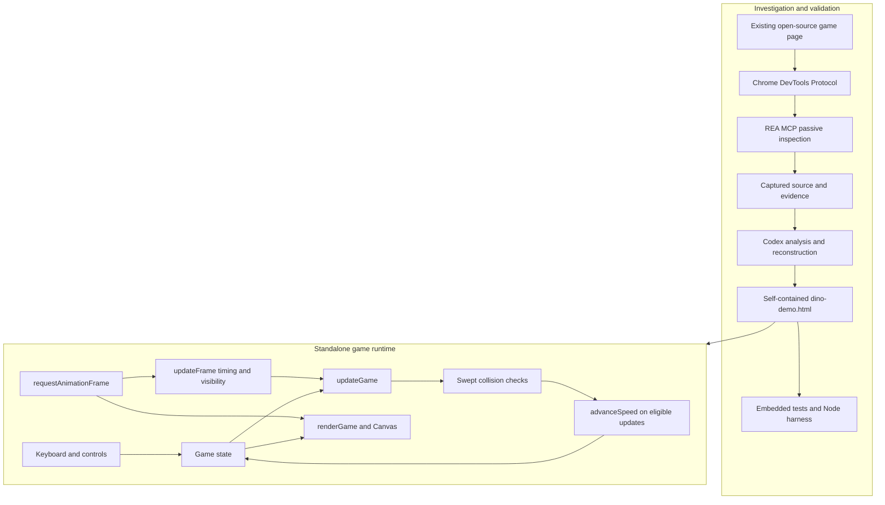

# Reverse Engineering a Browser Game with REA & Codex

[](https://awesomerea.org/resources/rea-dino-runner-community-case/)

A small software investigation turned into a playable, self-contained dinosaur runner. REA inspected the JavaScript loaded by an existing browser page through Chrome DevTools Protocol (CDP); Codex used the findings to build an independent HTML5 Canvas implementation and regression tests.

The project was built to practice evidence-based investigation, precise behavioral reconstruction, and validation of AI-assisted code. Its central example is subtle: movement uses elapsed time, but speed increases once per eligible update. Preserving that distinction matters more than matching the original appearance.

**[Live Demo](https://zhxunzh84.github.io/rea-dino-reverse-engineering/dino-demo.html)** · **[Source Code](https://github.com/zhxunzh84/rea-dino-reverse-engineering)**

Play the game directly in your browser without installation.

## Technologies

| Technology | Role |
| --- | --- |
| REA MCP | Browser target discovery and passive script inspection |
| Codex | Analysis, implementation, review, and test orchestration |
| Chrome DevTools Protocol | Access to the selected browser target and loaded scripts |
| JavaScript | Game logic, input handling, collision detection, and embedded tests |
| HTML5 Canvas and CSS | Original drawn artwork, rendering, and responsive controls |
| Node.js | Execution of the actual HTML script with mocked browser interfaces |

REA, Codex, CDP, and Node.js were development tools. Playing the game requires only a browser; there are no external assets, packages, or build steps.

## Architecture



Tests execute production logic synchronously and restore game state. They do not schedule a separate animation loop.

## Game features

- Space or ArrowUp to start and jump; Enter to restart when the game has keyboard focus.
- Pointer/touch interaction, obstacles, collision detection, scoring, and game-over state.
- Speed slider from 1 to 20 with a three-decimal live display.
- Auto Acceleration toggle with explicit restart and resume behavior.
- Swept rectangle collision detection to catch obstacles crossing the dinosaur between frames.
- Session best score retained after collisions and manual restarts.
- Embedded unit and integration tests, available through **Run speed tests**.

Inputs preserve native slider and checkbox keyboard behavior. Start, Restart, and the test button return focus to the canvas; Space/Enter on a focused button use native button activation.

## Evidence-driven workflow

1. Confirm the selected game page with `list_browser_targets`.
2. Inspect it using `inspect_web_page` with script sources enabled, without navigating, clicking, or evaluating page JavaScript.
3. Trace configuration, speed assignments, collision gating, and animation scheduling in the captured `index.js`.
4. Reimplement the verified speed rule with independently drawn artwork and simplified gameplay.
5. Review the implementation, reproduce defects, and add deterministic regressions and fault mutations.
6. Separate source findings, executed tests, and user-reported browser checks in the documentation.

See the [reverse-engineering report](docs/reverse-engineering.md) for source identity, evidence IDs, excerpts, and reconstruction boundaries.

## Source-Verified Acceleration Rule

The original default configuration is `SPEED = 6`, `ACCELERATION = 0.001`, and `MAX_SPEED = 13`. There is no original `INITIAL_SPEED` identifier; `SPEED` supplies the starting value.

The reconstruction implements:

```js
function advanceSpeed(speed, autoEnabled) {
  return autoEnabled && speed < 13 ? speed + 0.001 : speed;
}
```

The game calls this once per playing, collision-free logical update. There is no explicit clamp and no elapsed-time multiplier. Auto OFF holds the current speed; Auto ON resumes from it. Values at or above 13 remain unchanged. Restart uses 6 with Auto ON and retains the selected speed with Auto OFF.

**Frame-dependent caveat:** normal updates follow `requestAnimationFrame`, so more eligible updates per second produce faster acceleration in wall-clock time. The nominal 60 Hz movement scale does not enforce a 60 Hz update rate. Movement uses `currentSpeed * 60 * deltaSeconds`; the reconstruction caps elapsed time at 50 ms and skips updates while hidden.

Repeated floating-point additions from 6 leave update 7,000 just below 13. Update 7,001 adds again, settling near **13.001**. This is an observed numerical consequence of the threshold rule, not a different maximum setting.

## Run locally

Open [dino-demo.html](dino-demo.html) directly in Chrome. No server is required and the file works without network access.

Optionally, from the project directory:

```sh
python3 -m http.server 8000 --bind 127.0.0.1
```

Then open [the local game](http://127.0.0.1:8000/dino-demo.html). Stop the server with Ctrl+C. Python is optional and is not part of the game runtime.

**GitHub Pages deployment:** The published game is available at [https://zhxunzh84.github.io/rea-dino-reverse-engineering/dino-demo.html](https://zhxunzh84.github.io/rea-dino-reverse-engineering/dino-demo.html). GitHub Pages serves the self-contained `dino-demo.html` file directly; no installation is required to play.

## Testing and validation

The recorded final implementation result is **67 passed, 0 failed**: 15 pure-function tests and 52 integration tests. Ten deliberately faulty, in-memory variants were rejected. Additional harness checks covered one RAF chain after repeated restart, state restoration, and hidden-page timing.

The project owner reported **7/7 manual browser regression checks completed on 2026-10-13**. Those results are separate from the Node checks; the final UAT browser version and operating system were not supplied. The Chrome version recorded during the earlier REA source capture is not evidence of the final UAT browser version. There is no recorded CI or cross-browser coverage.

See [testing and reproduction instructions](docs/testing.md) for the actual HTML test entry points, a Node harness, mutation inventory, and UAT checklist.

## Screenshot


The existing project image at `screenshots/dino-game.png` shows the game-over scene and controls. It was present and visually inspected during documentation preparation; its browser environment and capture date were not supplied. It is not a screenshot generated by this documentation workflow. If the image is removed, replace this embed with a clearly labeled placeholder for the same path.

## Scope and learning outcomes

The reconstruction preserves the speed algorithm, not full game equivalence. It uses original Canvas artwork and simplified physics, obstacles, and scoring; it omits the original intro, ducking, audio, and mobile speed reduction. BEST is session-only. Swept collision uses inset rectangles and linear movement between frame endpoints. Rendering continues in ready and game-over states.

The work demonstrates MCP tool orchestration, source-based reasoning, explicit evidence boundaries, numerical edge-case analysis, and tests that detect faults in both a pure helper and its caller. [Lessons learned](docs/lessons-learned.md) distinguishes observed outcomes from suggested improvements.

## Acknowledgments and license status

- [wayou/t-rex-runner](https://github.com/wayou/t-rex-runner), the open-source game extracted from Chromium, and the Chromium authors acknowledged in its source.
- [REA](https://github.com/morluto/rea), used for passive browser inspection.
- Codex, used for the investigation and implementation workflow.

This project inspected available source code; it did not recover hidden proprietary code or reuse the original game assets. Documentation contains short source excerpts to explain the investigation.

The independently authored project is licensed under the [MIT License](LICENSE), with `Copyright (c) 2026 Xun Zhang`.

Upstream projects retain their own licensing and copyright: [REA's MIT license](https://github.com/morluto/rea/blob/main/LICENSE) belongs to its upstream copyright holder, and the [Chromium-derived T-Rex Runner's BSD-3-Clause license](https://github.com/wayou/t-rex-runner/blob/gh-pages/LICENSE) applies to its upstream material. This project's MIT license does not relicense the original source excerpts in the reverse-engineering report. Complete BSD repository terms and the original source-header attribution are supplied in [THIRD_PARTY_NOTICES.md](THIRD_PARTY_NOTICES.md); retain that file with distributions containing those excerpts. REA is a development tool, not vendored project code.

## Third-Party Acknowledgments

This project acknowledges the Chromium-derived [T-Rex Runner](https://github.com/wayou/t-rex-runner) as the investigation target and [REA](https://github.com/morluto/rea) as the development inspection tool. See [Third-Party Notices](THIRD_PARTY_NOTICES.md) for the material inventory, complete applicable BSD license text, copyright attribution, and the distinction between independently authored code and upstream excerpts. Upstream licenses remain separate from this project's MIT license.
